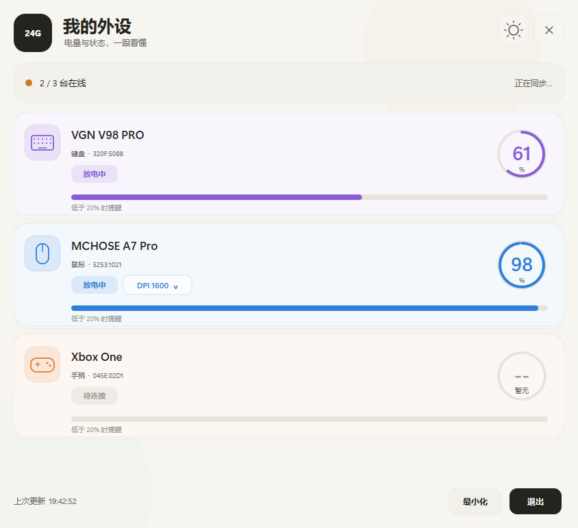
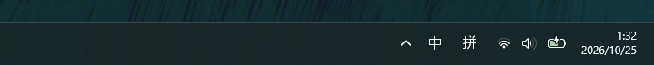

# 2.4G 外设电量

Windows 10/11 的 2.4G 无线外设电量托盘工具，基于纯 Python 标准库（`ctypes` + `tkinter`），**零第三方依赖**，不写日志。
二开Ap0LoG1zE/EZ2.4G修改，自用

当前已内置适配：

- **迈从 MCHOSE A7 Pro**：电量、充电状态、六档 DPI 读取与拖动修改
- **VGN V98 Pro 2.4G**：电量、充电状态
- **Xbox One / Xbox Series 手柄**：通过 Windows XInput 显示四档电量和连接状态



无论添加多少台设备，托盘始终只显示 **一个聚合图标**：



## 功能

- 无论连接多少台设备，托盘始终只显示一个聚合图标
- 鼠标悬停托盘图标，设备数据按“每台一行”上下排列，不挤在一起
- 顶栏太阳/月亮按钮切换深色/浅色主题，选择会被记住
- 深色玻璃卡片、状态胶囊、细腻进度条和抗锯齿图标，并针对高 DPI 屏幕优化字体
- 设备名称可自定义：双击名称文字，或右键选择「重命名设备」
- 设备类型以无边框文字显示，双击类型文字即可切换鼠标、键盘、耳机等类型
- 迈从 A7 Pro 支持 DPI 拖动条：默认折叠，点击「DPI 设置」展开；松开滑块后写入
- 实时显示「充电中」「已充满」「放电中」等设备状态
- 所有设备电量低于 `20%` 时弹出低电量提醒；每台设备只提醒一次，充电或恢复到 `25%` 以上后重新布防
- 多台设备同时低电量时合并为一条通知，避免连续弹窗
- 点击 `×` 或「最小化」会隐藏到托盘；点击底栏「退出」会完全关闭程序
- 新设备插入或重新拔插时弹窗确认，显示设备名、VID:PID 和当前电量
- 右键设备卡片可删除设备，同时清除对应协议和上次电量
- 自动刷新、开机自启（启动项名 `2.4G`）
- 未知设备可用内置 USBPcap 抓包助手保存电量协议

## 内置协议

| 型号 | VID:PID | 电量 | 充电状态 | DPI |
| --- | --- | --- | --- | --- |
| 迈从 A7 Pro | `5253:1021` | 支持 | 支持 | 六档读取/修改 |
| VGN V98 Pro | `320F:5088` | 支持 | 支持 | 不支持 |
| Xbox One / Series 手柄 | `045E:02D1` 等 | 四档 | 有线状态 | 不支持 |

### 迈从 A7 Pro

电量使用私有 Feature Report：

- 接口：UsagePage `0xFF01`
- Report ID：`0x11`
- 长度：完整 **65 字节**
- 查询帧：`11 F9 FF` + 62 个 `FF`
- 状态回包：`11 06` 后的状态体以 VID 小端序 `53 52` 开始
- 电量：状态体 `body[11]`
- 充电标志：状态体 `body[10]`
- 同时兼容明文状态体和旧固件的逐字节 `XOR 0xFF` 状态体

DPI 使用独立的配置 Report：

- Report ID `0x12`，命令 `0x67` 读取、`0x57` 写入
- 读取完整六档配置和当前活动档位
- 修改当前活动档位的 X/Y DPI 后原样写回，并回读确认
- 不会丢弃回报率、按键、传感器等本工具未建模的设置
- 命令之间保留最小间隔，避免配置通道被打乱

> DPI 拖动条在松开鼠标时才会写入设备。写入前请确认鼠标在线并唤醒，同时关闭厂家驱动，避免两个程序争用同一 HID 配置通道。

### VGN V98 Pro

- 接口：UsagePage `0xFF1C`、Usage `0x0092`
- 64 字节中断 OUT 查询帧：`04 00 00 1A 06 00 00 00`
- 回包前缀：`04 00 00 1A 06`
- 电量：`rep[8]`
- 充电标志：`rep[9] == 1`
- 电量达到 100% 时显示「已充满」

### Xbox One / Xbox Series 手柄

- 使用 Windows 自带的 XInput API，不依赖厂家驱动
- XInput 只提供「满 / 中 / 低 / 空」四档，界面中的 `100% / 70% / 30% / 5%` 是近似映射，不是精确容量
- 因此低电量提醒只会在「空」档触发，而不是按真实百分比触发
- USB 有线连接可识别为「有线模式」，但 XInput 不提供充电百分比
- 蓝牙或部分第三方充电电池组可能不上报电池数据；此时界面会显示「无电量数据」，而不是误报为未连接
- 刚更换电池或手柄重新连接后，XInput 可能短暂返回「未连接」；程序会自动退避重试，轻按手柄按键通常几秒内恢复
- 官方 Xbox 无线适配器通常比蓝牙提供更稳定的电量状态

## 使用方法

1. 启动软件。
2. **拔插一次接收器**，在发现设备弹窗中点击「添加」。
3. 双击设备名称文字，或右键设备卡片，可设置自定义名称。
4. 双击设备类型文字，可切换鼠标、键盘、耳机、音箱、手柄、接收器或其他类型。
5. 鼠标在线时，点击 A7 Pro 卡片的「DPI 设置」展开滑块，拖动后松开写入设备。
6. 点击顶栏太阳/月亮图标切换深色/浅色主题。
7. 左键点击托盘图标直接打开面板；右键打开菜单，可选择“打开外设中心”或“退出”。
8. 点击 `×` 或「最小化」隐藏到托盘；需要彻底结束程序时，点击底栏「退出」。
9. 设备电量低于 `20%` 时会自动弹出低电量提醒，无需额外设置。

如果读取不到电量：

- 先轻动鼠标或按一下键盘，让设备退出休眠。
- 关闭迈从/VGN 官方驱动后重试，避免私有 HID 接口被占用。
- A7 Pro 返回全零状态体时，工具会保留并标注上次电量，不会把全零误判为 0%。
- 若 DPI 显示「暂不可用」，重新拔插接收器并唤醒鼠标后刷新。
- Xbox 手柄首次识别或更换电池后请轻按手柄按键唤醒；程序会自动重试，XInput 只支持四档电量，无法显示真实百分比。

## 下载与运行

推荐直接运行免安装单文件版：

```text
release\2.4G外设电量.exe
```

- 不需要安装 Python，双击即可启动。
- 已打包为单个 exe，约 11 MB。
- 首次启动需要解包，可能会比后续启动稍慢。
- exe 未签名，Windows SmartScreen 可能提示；选择“更多信息 → 仍要运行”。
- 如果旧版本仍在托盘运行，请先打开面板并点击「退出」，再启动新版，避免单实例检查只唤起旧窗口。

### 从源码运行

需要 Windows 10/11 x64 和 Python 3.10+（包含 `tkinter`）：

```bat
python my_devices.py
```

也可以直接双击 `启动.bat`，脚本会自动查找 `pyw.exe`、`pythonw.exe` 或 `python.exe`。

常用命令：

```bat
python my_devices.py            :: 托盘常驻
python my_devices.py --once     :: 读取一次并打印
python my_devices.py --list     :: 列出 HID 接口
python my_devices.py --panel    :: 只打开面板，不常驻托盘
python my_devices.py --install  :: 创建开机自启和桌面入口
```

配置文件位于 `%APPDATA%\BatteryTray\config.json`，保存已添加设备、自定义名称、协议、上次电量、刷新间隔、面板主题和 USBPcap 路径。

## 未知设备抓包

1. 安装 [USBPcap](https://desowin.org/usbpcap/)，重启电脑。
2. 插拔要适配的设备，在弹窗中点击「添加」。
3. 关闭厂家驱动，点击「开始抓包」并允许管理员权限。
4. 打开厂家驱动，让它显示一次电量。
5. 点击「停止」，填入刚才看到的电量。
6. 只有一个字节匹配时，保存请求帧和电量字节位置。
7. 多个字节匹配时，换一个相差 10% 以上的电量再抓一次并对比。

保存后会立即回读验证。抓包分析会排除描述符、EP0 标准控制请求、字符串描述符和全零报告。

## 限制

- 仅支持 Windows 10/11 x64。
- 内置适配目前覆盖迈从 A7 Pro、VGN V98 Pro 和常见 Xbox One/Series 手柄；其他型号可使用标准 HID 电量或抓包助手适配。
- 电量由设备自身上报，可能以 5% 或其他粒度跳变。
- 充电状态取决于固件是否在电量回包中提供有效标志；未提供时只能显示电量。
- DPI 修改目前仅支持迈从 A7 Pro，写入范围为 `100`–`26000`，步进 `100`。
- 加密或需要私有握手的协议无法仅靠抓包还原。
- 厂家驱动可能独占设备；遇到读取或写入失败时请先关闭官方驱动。

## 文件

- `release\2.4G外设电量.exe`：免安装单文件版
- `my_devices.py`：主程序，内置设备协议和抓包助手
- `app.ico`：程序图标
- `启动.bat`：自动寻找 Python 的启动脚本
- `docs/panel.png`：面板截图
- `docs/tray.png`：单托盘聚合图标截图
